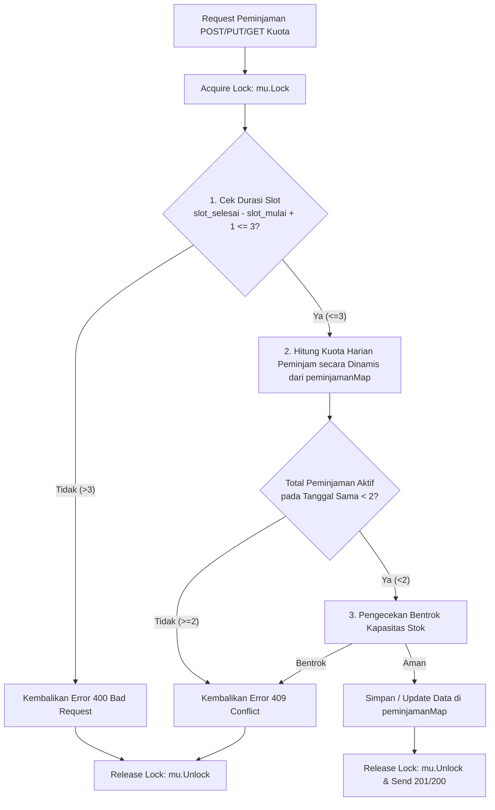

# PROSES

## 1. Persona dan masalahnya

Aplikasi yang dibuat untuk mahasiswa dan manajemen aset (lebih spesifik aset proyektor dan kabel). App dibuat dengan harapan dapat menyelesaikan masalah utama kebiasaan mahasiswa yang memborong proyektor dan kabel. Dimana dalam aturan bisnis birokrasi seharusnya ada batasan tertentu (disini 3 slot saja) dan hanya dapat meminjam 2 peminjaman saja setiap harinya (eg., siang 1 peminjaman dan sore 1 peminjaman). Dimana dengan ini harapannya inventaris kabel dan juga proyektor dapat memenuhi kebutuhan seluruh mahasiswa tanpa adanya perlakuan hoarding oleh sekelompok orang.[cite: 1]

---

## 2. Rancangan struktur data

| Kategori Data | Nama Variabel / Type | Tipe Data Go | Fungsi & Alasan Pemilihan |
| :--- | :--- | :--- | :--- |
| **Penyimpanan Utama (Store)** | `sumberDayaMap` | `map[int]SumberDaya` | Menyimpan seluruh data sumber daya (ruang/alat) dengan *key* `id`. Menggunakan `map` untuk pencarian, pengubahan, dan penghapusan data ber-kompleksitas $O(1)$.[cite: 2] |
| | `peminjamanMap` | `map[int]Peminjaman` | Menyimpan seluruh data peminjaman dengan *key* `id`. Menggunakan `map` agar operasi `PUT`, `DELETE`, dan detail `GET` per ID dapat dilakukan secara instan $O(1)$.[cite: 2] |
| **Auto-Increment ID** | `nextSumberID` | `int` | Generator ID otomatis untuk sumber daya baru, dimulai dari `1` dan bertambah $1$ setiap pembuatan data baru.[cite: 2] |
| | `nextPeminjamID` | `int` | Generator ID otomatis untuk peminjaman baru, dimulai dari `1` dan bertambah $1$ setiap pembuatan data baru.[cite: 2] |
| **Sinkronisasi Concurrency** | `mu` | `sync.Mutex` | Pengunci data bersama (*shared memory*) untuk menjamin *thread-safety* dari *race condition* saat banyak *request* masuk bersamaan.[cite: 2] |
| **Objek Sumber Daya** | `ID` | `int` | Identifier unik sumber daya (`json:"id"`).[cite: 2] |
| | `Nama` | `string` | Nama ruang/alat (`json:"nama"`), maksimal 50 karakter setelah di-*trim*.[cite: 2] |
| | `Jenis` | `string` | Kategori sumber daya (`json:"jenis"`), nilainya `"ruang"` atau `"alat"`.[cite: 2] |
| | `Stok` | `int` | Jumlah unit yang tersedia (`json:"stok"`), minimal 1.[cite: 2] |
| **Objek Peminjaman** | `ID` | `int` | Identifier unik peminjaman (`json:"id"`).[cite: 2] |
| | `SumberDayaID` | `int` | Reference ID ke `SumberDaya` yang dipinjam (`json:"sumber_daya_id"`).[cite: 2] |
| | `Peminjam` | `string` | Nama peminjam (`json:"peminjam"`), maksimal 50 karakter setelah di-*trim*. |
| | `Tanggal` | `string` | Tanggal peminjaman (`json:"tanggal"`) dalam format `YYYY-MM-DD`. |
| | `SlotMulai` | `int` | Slot jam mulai (`json:"slot_mulai"`), bernilai 1–8.[cite: 1, 2] |
| | `SlotSelesai` | `int` | Slot jam selesai (`json:"slot_selesai"`), bernilai 1–8 dan $\ge$ `slot_mulai`.[cite: 1, 2] |
| | `Jumlah` | `int` | Jumlah unit yang dipinjam (`json:"jumlah"`), bernilai $1 \le \text{jumlah} \le \text{stok}$.[cite: 2] |
| | `Status` | `string` | Status peminjaman (`json:"status"`), nilai awal `"aktif"`.[cite: 2] |
| **Format Return API (Slice)** | `[]SumberDaya` | `[]SumberDaya` | Digunakan saat merespons `GET /sumber-daya`. Nilai dari `sumberDayaMap` dikonversi ke *slice* lalu diurutkan menaik (*ascending*) berdasarkan `id`.[cite: 2] |
| | `[]Peminjaman` | `[]Peminjaman` | Digunakan saat merespons `GET /peminjaman`. Nilai dari `peminjamanMap` dikonversi ke *slice* (setelah difilter), lalu diurutkan menaik (*ascending*) berdasarkan `id`.[cite: 2] |

---
## 3. Satu keputusan desain

## 4. Bug atau kendala (minimal dua)

### Bug 1
- Gejala: Saat melakukan pengubahan data (`PUT /peminjaman/{id}`), server mengembalikan status `409 Conflict` padahal slot dan tanggal yang diubah tidak bentrok dengan peminjaman milik orang lain[cite: 3].
- Cara menemukan: Melakukan pengujian request `PUT` di Postman untuk memperbarui jam slot pada ID peminjaman yang sama[cite: 3].
- Penyebab dan solusi: Fungsi pemeriksaan bentrok dan kuota ikut menghitung data peminjaman lama dari ID yang sedang diubah (menghitung dirinya sendiri dua kali)[cite: 3]. Solusinya, tambahkan pengecekan `if item.ID == excludeID { continue }` saat iterasi agar data peminjaman yang sedang di-update diabaikan dari perhitungan bentrok dan kuota[cite: 3].

### Bug 2
- Gejala: Urutan data pada respon `GET /sumber-daya` dan `GET /peminjaman` berubah-ubah secara acak setiap kali endpoint dipanggil[cite: 3].
- Cara menemukan: Membandingkan hasil respon `GET` di Postman secara berulang kali[cite: 3].
- Penyebab dan solusi: Penggunaan tipe data `map` di Go memiliki sifat bawaan urutan iterasi yang tidak konstan (random order)[cite: 3]. Solusinya, konversi data dari `map` ke bentuk `slice` terlebih dahulu, lalu lakukan pengurutan eksplisit menggunakan `sort.Slice` berdasarkan `ID` secara menaik (*ascending*) sebelum dikirim sebagai respons JSON[cite: 3].

## 5. Change request

## Keputusan Desain Tambahan (Change Request A)
- Keputusan: Mengambil seluruh sumber daya dari store lalu menyusun array per_sumber_daya dengan default jumlah_peminjaman 0[cite: 9].
- Alasan: Aturan Change Request A mewajibkan semua sumber daya yang ada tetap ditampilkan dalam array per_sumber_daya secara terurut berdasarkan ID, meskipun belum memiliki peminjaman.

